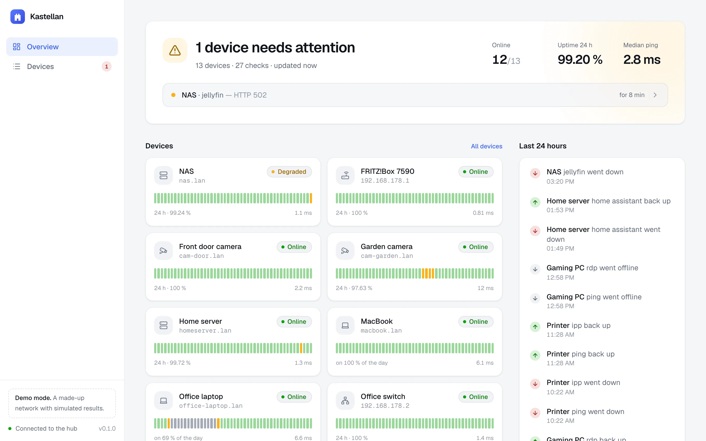

# Kastellan

Every device on your network, in one place.

Kastellan is a self-hosted hub that watches your router, access points, switches, servers, PCs,
laptops, printers and cameras. It answers whether everything is all right, and if not, what is
wrong, since when, and what the device is connected through. It is early: today it watches;
next it learns to look after things (a terminal and remote desktop in the browser, device
drivers, updates, backups). See [PLAN.md](PLAN.md).



## What it does today

- **Checks**: ping, TCP ports and HTTP endpoints per device, on an interval.
- **Overview**: one line saying whether anything needs you, the failing checks, every device's
  last 24 hours as a strip, and the ups and downs of the day.
- **Calm by default**: a PC or laptop that is off is *offline*, not *down*.
- **Device pages**: response times, uptime over 1 h / 24 h / 7 d, and the activity of each check.
- **List or graph**: the devices as a searchable list, or as a graph of what is connected
  through what (infrastructure only; which access point a laptop uses isn't drawn).
- **Plain files**: `config.yaml` for the configuration, one CSV file per day for the history.

## Try it

Kastellan has no release yet. From a checkout, with [uv](https://docs.astral.sh/uv/) and
Node.js 24:

```sh
cd frontend && npm install && npm run build && cp -r build ../backend/src/kastellan/web
cd ../backend && KASTELLAN_DEMO=1 uv run kastellan
```

Open http://localhost:8100. Demo mode shows a made-up network with a day of simulated history;
nothing on your network is contacted.

With Docker: `docker compose up -d --build` (see [compose.yaml](compose.yaml)).

## Your own network

Copy [config.example.yaml](config.example.yaml) to `data/config.yaml` (Docker:
`config/config.yaml`) and describe your devices:

```yaml
devices:
  router:
    host: 192.168.178.1
    kind: router
    checks:
      - ping
      - http: https://192.168.178.1
  nas:
    host: nas.lan
    kind: server
    parent: router
    checks:
      - ping
      - tcp: 22
        name: ssh
```

Kastellan picks up changes to the file by itself. Run it without `KASTELLAN_DEMO`.

Settings (environment): `KASTELLAN_CONFIG` (default `data/config.yaml`), `KASTELLAN_DATA`
(default: the config's folder), `KASTELLAN_HOST`, `KASTELLAN_PORT` (8100),
`KASTELLAN_LOG_LEVEL`, `KASTELLAN_DEMO`.

## Security

Kastellan has no sign-in yet. Run it only where your own network or VPN can reach it, never
on the internet. The security design (keys instead of passwords, per-device limits, roles,
updates only on known vulnerabilities of internet-facing devices) is in [PLAN.md](PLAN.md).

## License

MIT
